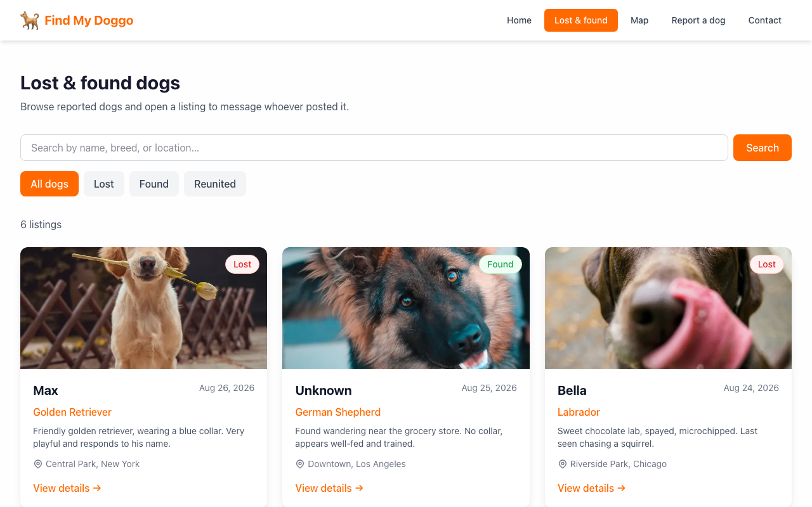

# Find My Doggo

A lost-and-found dog noticeboard: anyone can post a dog with a photo and location,
browse or search the listings, see them on a map, and message the person who
posted. No account, no login.

The design decision that matters is that the reporter's email address, the one
piece of personal data the app holds, never leaves the server. Every read path
goes through `toPublicDog` in `website/src/lib/dogs.ts`, which strips the contact
fields before a record can reach a page, an API response, or the sitemap; enquiries
go through `POST /api/messages`, which resolves the address server-side. A unit
test asserts this directly. Rebuilt as a Next.js app from a 2019 HackMerced
dog-photo classifier, none of which survives in the tree.

## Status

**Private beta.** There is no public deployment yet: the 2019 Heroku app is gone and
nothing has replaced it, so the only way to use Find My Doggo today is to run it locally
(below). Things may break. Support is `support@lscaturchio.xyz` (the address in the
footer; set `SUPPORT_EMAIL` to change it), and the quickest way to report a problem is
the **Feedback** link in the header or the "tell us" link in the footer, which saves a
note to the database and emails support when a mailer is configured. `GET /api/health`
lists every optional integration a deployment has actually turned on.

<p align="center">
  
</p>

## Quick start

Requires Node.js 20 or newer.

```bash
cd website
npm install
npm run seed     # optional: load six sample listings
npm run dev
```

Open <http://localhost:3000>. No configuration is needed: the app creates a local
SQLite database at `website/data/dev.db` and writes uploaded photos to
`website/data/uploads`.

## How it works

| Concern         | Local development                      | Production                                   |
| --------------- | -------------------------------------- | -------------------------------------------- |
| Database        | SQLite file (`data/dev.db`)            | Hosted libSQL / Turso via `DATABASE_URL`      |
| Photo uploads   | `data/uploads` on disk               | Vercel Blob via `BLOB_READ_WRITE_TOKEN`       |
| Geocoding       | OpenStreetMap Nominatim                | Same (set `GEOCODER_USER_AGENT`)              |
| Map tiles       | OpenStreetMap                          | Same                                          |
| Enquiry emails  | Logged to the console                  | Resend via `RESEND_API_KEY`                   |
| Contact + feedback | Stored, logged to the console        | Stored, then emailed to `SUPPORT_EMAIL`       |

Each of these switches over automatically when the relevant environment variable is
present, so the same code runs in both places. Copy `website/.env.example` to
`website/.env.local` to configure them.

`GET /api/health` reports whether the database is reachable (and how long it took),
the running version, and a `features` object with one boolean per optional
integration. The UI follows the same flags: a contact message or enquiry that could
not be emailed says "saved" rather than "sent", and a report whose address could not
be geocoded says so instead of promising a map pin.

## Project layout

```
website/
├── src/
│   ├── app/
│   │   ├── api/          # REST handlers: dogs, messages, feedback, health
│   │   ├── dogs/         # listings and per-dog detail pages
│   │   ├── map/          # Leaflet map view
│   │   ├── report/       # report submission form
│   │   └── contact/      # general contact form
│   ├── components/       # navbar, footer, cards, map, forms
│   └── lib/              # database, validation, storage, geocoding, rate limiting
├── scripts/seed.mjs      # sample listings
└── tests/
    ├── unit/             # Vitest
    └── e2e/              # Playwright
```

## Commands

Run from `website/`:

| Command             | What it does                                        |
| ------------------- | --------------------------------------------------- |
| `npm run dev`       | Development server                                   |
| `npm run build`     | Production build (also typechecks)                   |
| `npm start`         | Serve the production build                           |
| `npm run seed`      | Load sample listings (idempotent)                    |
| `npm run lint`      | ESLint                                               |
| `npm run typecheck` | `tsc --noEmit`                                       |
| `npm test`          | Vitest unit tests                                    |
| `npm run test:e2e`  | Playwright end-to-end tests (needs a build first)    |
| `npm run check:env` | Environment audit; `-- --production` fails on missing production values |
| `npm run smoke -- <url>` | Read-only smoke against a running deployment (pages + `/api/health`) |

## Deploying

Nothing is deployed yet; `docs/LAUNCH_CHECKLIST.md` is the ordered list of
dashboard steps that gets from here to a public URL, and the notes below are the
repo-side facts it relies on.

**Vercel project.** Import the GitHub repository with **Root Directory `website`**
(there is no root `package.json`), framework Next.js, Node 22. Vercel then records
each deploy as a GitHub Deployment, which is what `.github/workflows/deploy-watchdog.yml`
checks daily: it warns while no Vercel project is connected, and fails once one is
and master has no successful Production deployment.

**Environment.** Every variable the app reads, with what breaks without it:

| Variable                | Needed in           | Without it                                                        |
| ----------------------- | ------------------- | ----------------------------------------------------------------- |
| `DATABASE_URL`          | preview, production | Falls back to a SQLite file the serverless instance loses          |
| `DATABASE_AUTH_TOKEN`   | preview, production | Turso refuses the connection; `/api/health` reports it unreachable |
| `BLOB_READ_WRITE_TOKEN` | preview, production | Photos go to local disk and vanish on redeploy                     |
| `RESEND_API_KEY`        | production          | Enquiries, contact messages and feedback are stored, not emailed  |
| `NOTIFY_FROM_EMAIL`     | production          | Same: email delivery needs both (on a domain verified in Resend)   |
| `GEOCODER_USER_AGENT`   | production          | Nominatim policy violation; include a contact address              |
| `GEOCODER_URL`          | optional            | Public Nominatim is used (about one request per second)            |
| `DISABLE_GEOCODING`     | optional            | Geocoding is on; `1` turns it off (tests, offline)                 |
| `NEXT_PUBLIC_SITE_URL`  | optional            | Inferred from Vercel; set it once a custom domain is attached      |
| `SUPPORT_EMAIL`         | optional            | Defaults to `support@lscaturchio.xyz`                              |
| `FEEDBACK_REVIEW_TOKEN` | optional            | `GET /api/feedback` is a 404                                       |

`npm run check:env -- --production` (from `website/`, after `vercel env pull
.env.local --environment=production`) prints that table against the pulled
values, set/unset only, and exits 1 while anything production needs is missing or
malformed. The same table lives in `website/scripts/lib/env-spec.mjs` and a unit
test keeps it equal to `.env.example`.

**After deploying.** `npm run smoke -- https://<url>` fetches every public page,
`robots.txt`, the sitemap and `GET /api/health`, fails on any non-2xx or a health
status other than `ok`, and prints the `features` flags so you can see which of the
integrations above the deployment actually has. Set the repository variable
`PRODUCTION_URL` and the watchdog runs the same smoke every day.

## Known limitations

These are deliberate gaps, not bugs:

- **No accounts.** Anyone can post, and nobody can edit or delete their own
  listing. Takedowns go through the contact form, which reaches `SUPPORT_EMAIL`
  once a mailer is configured.
- **Feedback has no inbox UI.** Notes land in the `feedback` table; reviewers read
  them with `GET /api/feedback` and `Authorization: Bearer $FEEDBACK_REVIEW_TOKEN`
  (the route is a 404 until that variable is set); `?undelivered=1` lists the ones
  that were stored but not emailed.
- **Support mail is capped.** The contact form and the feedback dialog each send at
  most 20 emails an hour in total; past that, messages are still stored and the UI
  says so. `GET /api/health` reports `mail.contact` / `mail.feedback`.
- **No moderation.** Submissions are validated but not reviewed. A public
  deployment needs a moderation queue and abuse reporting.
- **Rate limiting is per-instance.** The in-memory limiter in `lib/rate-limit.ts`
  slows down a single client but does not survive a scale-out. Front it with a
  shared store or a platform WAF rule before opening it up.
- **Overlapping map pins.** Dogs reported close together are hard to click apart
  at low zoom. Marker clustering would fix this.
- **No listing expiry.** Nothing ages out or gets archived automatically.
- **Nominatim rate limits.** Roughly one geocode per second, shared across the
  deployment. A busy site needs a paid geocoder.

## Licence

GPL-3.0. See [LICENSE](LICENSE).
